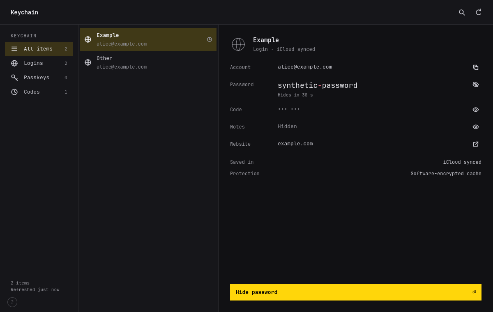
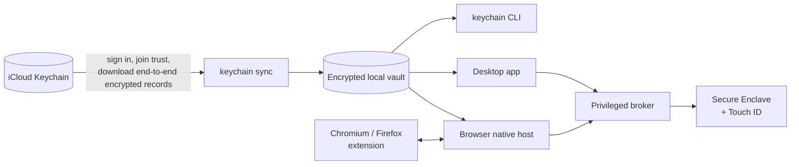

<h1 align="center">Keychain</h1>

<p align="center">
  <strong>Your iCloud Keychain, on Linux.</strong><br>
  Apple Passwords, verification codes and passkeys in your terminal, on your desktop and in your browser.<br>
  On Apple silicon Macs running Asahi Linux, protected by the Secure Enclave and unlocked with Touch ID.
</p>

<p align="center">
  <picture>
    <source media="(prefers-color-scheme: light)" srcset="docs/images/desktop-light.png">
    
  </picture>
  <br><sub>The desktop app, showing synthetic test data.</sub>
</p>

---

Keychain doesn't export or scrape your passwords. It joins your iCloud Keychain
the same way a new iPhone or Mac does: it signs in with your Apple ID, joins your
trusted devices using the passcode of one of them, then downloads your keychain
and decrypts it **on your machine**. This works with Advanced Data Protection too.

You don't need a Mac, Python, a container or a background service. It is one Rust
program, plus a small helper that handles Apple's device attestation locally.

> [!NOTE]
> Keychain is an unofficial, experimental reverse-engineering project. It is not
> affiliated with or endorsed by Apple. It reads your keychain, and it changes
> your account only when you explicitly confirm a change, such as joining your
> trusted devices.

## Highlights

- **The real protocol, end to end.** A native Rust implementation of Apple's
  sign-in (including two-factor), Octagon device trust and CKKS end-to-end
  decryption. It has been tested against a live account with Advanced Data
  Protection.
- **One keychain, three ways to use it.**
  - **The `keychain` command:** list, search, show and get codes, with JSON
    output for scripts.
  - **A keyboard-first desktop app** that follows your Omarchy theme.
  - **Extensions for Chromium and Firefox/LibreWolf.**
- **Passkeys that work in your browser.** Your synced iCloud passkeys sign in to
  websites in Chromium. On a Mac with the Secure Enclave driver, you can also
  create new passkeys that never leave this machine.
- **Touch ID on Linux.** With Apple's Secure Enclave available, a password
  you've protected appears only after a fresh fingerprint, and a passkey's
  private key stays inside the enclave. A native prompt says exactly which site
  and account each touch is for.
- **Careful by default.**
  - Everything is encrypted at rest.
  - A sync never replaces your vault with an incomplete one.
  - The one step that spends a limited Apple recovery attempt always asks first.
  - TLS verification can't be turned off.
  - Revealed secrets hide again after 30 seconds.

## How it works



1. **Sign in.** Keychain authenticates with your Apple ID and two-factor code,
   which you can receive on your trusted devices or by text message. Your Apple
   ID password is never saved.
2. **Join.** Your trusted devices hold the keys to your keychain. Keychain asks
   to join them using your device passcode. You confirm this once, and it is
   guarded.
3. **Sync.** Keychain downloads your keychain records and decrypts them locally
   into an encrypted vault. It refuses partial or undecryptable snapshots.
4. **Use.** Listing, searching and browsing use metadata only. A password,
   code or note is shown only when you ask for that one. Protected items go
   through a small privileged broker to the Secure Enclave, which asks for your
   fingerprint every time.

## Status

| Tested live (real account or real hardware) | Tested with synthetic data | In progress |
| --- | --- | --- |
| Sign-in, two-factor and joining trust | Firefox/LibreWolf passkeys | Creating iCloud passkeys (built, off by default) |
| Sync with Advanced Data Protection | Password and code filling in Chromium and LibreWolf | One-touch unlock sessions (waiting on kernel support) |
| Passwords, notes and codes from the CLI | The desktop app | Saving and updating passwords, generating passwords |
| iCloud passkey sign-in in Chromium | Fingerprint-protected password reveal | Background sync |
| Device-only passkeys in the Secure Enclave, with Touch ID | | Payment cards and Hide My Email |
| Fingerprint-gated signing with the native prompt | | |

Keychain is developed and tested on Asahi Linux on an M1 MacBook Pro. The core
CLI doesn't need Apple hardware, but other machines haven't been tested yet.

## Quick start

You need Rust 1.85 or newer. You also need the
[local anisette helper](helpers/mac-anisette/README.md), which provides Apple's
device attestation by emulating it on your machine. You supply the Apple library
it runs.

```sh
cargo build --release
alias keychain="$PWD/target/release/keychain"

keychain anisette setup --helper "$HOME/.local/libexec/keychain-anisette-mac"
keychain setup          # sign in, two-factor, then join your trusted devices
keychain sync           # download and decrypt your keychain
keychain list           # everything, without revealing secrets
keychain show 3f2a      # one item, by ID or unique ID prefix from `list`
keychain totp 3f2a      # just the current verification code
```

> [!WARNING]
> `setup` (and `join`) asks for the passcode of one of your Apple devices to join
> your trusted devices. Apple allows only a few attempts, and too many wrong
> passcodes can permanently damage your account's recovery. Keychain shows which
> device record it will use, explains the limit, and asks before spending an
> attempt. Read the [command-line guide](docs/USAGE.md) first.

## Desktop app

```sh
desktop/bin/build                # needs Qt 6
./target/release/keychain gui
```

- **Search-first and keyboard-first.** Type to find an account, use the arrow
  keys to move, Enter for the main action, and `?` for every shortcut.
- **Deliberate reveals.**
  - Passwords, codes and notes appear only when you ask, one field at a time.
  - They hide again after 30 seconds or when you leave the window.
  - Protected items ask for your fingerprint.
- **Fits your desktop.** It follows the live Omarchy palette and Hyprland's
  corner rounding, and its design is adapted from Omarchy's
  [Folio](https://github.com/omacom/folio).

`desktop/bin/install` packages it for Arch/Omarchy so it appears as **Keychain**
in the launcher. See [desktop build and tests](desktop/README.md) and the
[design notes](docs/DESKTOP-UI.md).

## Browser extension

One extension core serves Chromium and Firefox/LibreWolf. It signs in to
websites with your passkeys and fills fingerprint-protected passwords and current
verification codes into HTTPS forms. It never submits a form for you, and it
never receives notes or code seeds. See
[installation and the browser security model](browser/README.md).

## Touch ID and the Secure Enclave

On Apple silicon Macs, Keychain can use the Mac's own Secure Enclave. This
requires a kernel with the Secure Enclave key driver, which is in review as
[aurora-silicon/linux#2050](https://github.com/aurora-silicon/linux/pull/2050). With it:

- **Protect existing items.** `keychain protect ID` moves a login or passkey
  behind your fingerprint, keeping an encrypted recovery copy.
- **Create device-only passkeys.** New passkeys are made inside the enclave and
  their private keys never leave it.
- **One prompt for every touch.** A short-lived native window names the
  operation, site and account, and cancels if you switch away. A
  [D-Bus contract](docs/TOUCHBAR-KEYCHAIN-IMPLEMENTATION.md) lets a Touch Bar
  host mirror that prompt.

See [service deployment](contrib/SEP-SERVICES.md) and the
[Secure Enclave design](SEP-IMPLEMENTATION.md).

## Security at a glance

- Account tokens, device keys and your vault are encrypted with
  XChaCha20-Poly1305 under purpose-separated keys, in files only you can read.
- Your Apple ID password, two-factor codes, device passcode and transport keys
  are never stored.
- Without the Secure Enclave, the root key is a file. Another program running as
  your user could read it, so protect your Linux account and leave
  `software.key` out of backups.
- With the Secure Enclave, protected secrets need a fresh fingerprint, and
  device-only passkey keys never exist outside the enclave.

The full model and its limits are in the
[command-line guide](docs/USAGE.md#local-security-model) and the
[design document](DESIGN.md).

## Documentation

| | |
| --- | --- |
| [Command-line guide](docs/USAGE.md) | Setup, two-factor, trust repair, every command, the local security model |
| [Design](DESIGN.md) | Architecture, protocol boundaries and goals |
| [Sync recovery](docs/SYNC-RECOVERY.md) | Incomplete syncs, expired sign-ins, repairing trust |
| [Browser](browser/README.md) | Installing the extension, filling, the trust model |
| [Desktop app](desktop/README.md) | Building, testing and packaging the app |
| [Secure Enclave](SEP-IMPLEMENTATION.md) | Native signing, protected items, creation, migration |
| [Anisette helper](helpers/mac-anisette/README.md) | Building the local attestation helper |

## License

Keychain is released under the [MIT License](LICENSE). The anisette helper is a
separate [GPL-2.0-only](helpers/mac-anisette/LICENSE) program that Keychain runs
but doesn't link, and Apple's library is not included. Adapted design patterns
are credited in [third-party notices](desktop/THIRD-PARTY-NOTICES.md).

Apple, iCloud and Touch ID are trademarks of Apple Inc. This project is
not affiliated with Apple.
