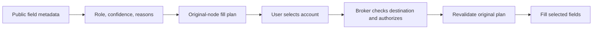

# Browser field detection and guarded filling

The browser supports passwords, usernames (including passkey account names) and
current TOTP codes. Classification must grow without adding site-specific cases
to the request controller. This design uses deterministic local rules and public
DOM metadata. There is no remote classification service or runtime rule download.

## Responsibilities and dependencies

| Module | Responsibility | Excludes |
| --- | --- | --- |
| `shared/forms/classifier.js` | Pure metadata classification and unique-best selection | DOM, field values, browser APIs, native requests |
| `shared/forms/dom.js` | Public metadata collection, coherent groups, immutable original-node plans, validation and field writes | Account lookup, menus, authorization |
| `shared/forms/menu.js` | Closed-shadow menu, public labels, keyboard navigation, user-selection callbacks | Classification, native messaging, secret values |
| `shared/forms.js` | One-use request lifecycle, account selection, cancellation, ephemeral reply cleanup | Heuristic dictionaries and markup |
| `shared/forms-background.js` | Browser-authenticated origin, metadata inspection, pinned item selection, native-port cancellation | Page-supplied origin, DOM interpretation, secret persistence |
| Native host and root broker | Destination/item policy, native authorization and selected field release | Trust in classification as permission |

Both browser manifests load the same modules in dependency order. The existing
packager copies them without a bundler or production JavaScript dependencies.

## Classification contract

`analyze(fields, context)` accepts bounded plain descriptors and returns form
intent plus a decision per field. A decision has `role`, `confidence` and stable
`reasons`. Roles are username, password, TOTP, new-password, excluded and unknown.
Confidence is explicit, strong, contextual or none. **Explicit means an HTML
hint, not authenticated evidence.** These outputs affect suggestions only.

Rules consider autocomplete tokens, labels, `aria-label`, `aria-labelledby`,
name/ID, placeholder, input type, field order, form headings and submit labels.
HTML attributes are read directly: Firefox can omit unsupported tokens from the
reflected `autocomplete` property. Hints are normalized and bounded. Editable
values are never classification inputs; submit-button labels are public context.

Negative signals precede positive guesses: search/newsletter/payment forms,
credit-card/postal/discount inputs, new/confirm passwords, recognizable SMS or
recovery codes, and unsupported or segmented inputs. Signup/reset forms do not
receive existing-password suggestions. Explicit current-password inputs remain
usable in change-password forms. A password is never inferred into an unmasked
text input just because it claims `autocomplete="current-password"`.

Context can identify a sole unknown text input before a password, or a sole
unknown input in a username-first sign-in form. Competing candidates are ranked
by confidence. A tied ranking produces no automatic pairing. Multiple unlabeled
passwords remain ambiguous. Code detection requires a hint or authenticator
context; six numeric characters alone are insufficient evidence for TOTP.

## DOM plans and lifetime

Collection groups controls by their real `form` association. Formless controls
use a nearby explicit form/fieldset/section/dialog group; the document body is a
bounded fallback without global heading/button inference. Other forms do not
lend usernames or password fields. At most 64 relevant inputs, four labels and
four referenced ARIA labels per input, eight submit controls and bounded text
are considered. Collection does not retain a page-wide metadata cache.

A plan retains the original input objects, group, form membership, page URL,
resolved action/method/target and a public-descriptor/classification fingerprint.
The target controls’ routing attributes are compared in full, independently of
the classifier’s text bounds. It is validated before account presentation, on selection, before delivery and
again after username input handlers before a password write. Added/replaced or
reassigned inputs, changed labels/hints, visibility, group intent or form details
invalidate the original plan. Values are not fingerprinted. Hidden, disabled,
read-only, occluded and inert controls are not eligible; ancestor visibility and
opacity and disabled fieldsets are checked.

Delegated focus/pointer events inspect newly inserted fields when used. There is
no observer that scans the entire page for every DOM mutation. Validation
recollects the original bounded group when a pending operation progresses.
Navigation, hiding the document, disconnect, disable, Escape and deadlines retain
the existing revocation behavior. Page-controlled menu presentation is not a
trusted authorization surface; native prompts show the actual destination.

## Explicit fallback

For an unknown focused field, the extension toolbar can offer a manual role.
This creates a new normal account-selection request, not an authorization grant.
The proposal is bound to that exact field and public snapshot by a one-use token
with a 30-second expiry. It is refused after focus/document/snapshot changes.
Only the extension's own toolbar control handler can start the background action.
Manual plans target just the selected field and do not infer sibling fields.
Password fallback requires a masked password input. Excluded, new-password,
segmented, hidden and unsafe-destination controls cannot use this fallback.

## Tests and maintenance

`tests/fixtures/fields.json` is the shared behavior corpus. Pure tests assert roles
and pairing. The real-browser harness renders the same descriptors into local
HTML and checks the packaged Chromium and LibreWolf adapters, including negative
cases, dynamic/formless inputs and manual fallback. Additional lifecycle tests
cover changed labels/intent/controls during authorization and stale manual
proposals. Providers and credentials in automated browser tests are synthetic.

For a new compatibility issue, add a minimal fixture with a behavior expectation,
then change the relevant collector, classifier or binder. Keep site-name checks
out of the controller. Test false-positive neighbors of new rules, not just the
reported positive case. Reason codes are available in tests and in memory; they
are not telemetry and field metadata is not logged.

Current limits: English heuristic vocabulary, top-level HTTPS documents, ordinary
input controls, and no segmented-code distribution, shadow-root traversal or
cross-origin frame filling. Conditional WebAuthn mediation remains a separate
feature. These limits should be extended through explicit collector/group and
browser-identity work rather than weakening destination checks.

Reference research: [Bitwarden's field classifier](https://github.com/bitwarden/clients/blob/main/apps/browser/src/autofill/services/inline-menu-field-qualification.service.ts)
and [autofill architecture](https://contributing.bitwarden.com/architecture/deep-dives/autofill/generating-fill-scripts/).
The implementation and fixtures here are original; no external extension code or
heuristic tables were copied.
