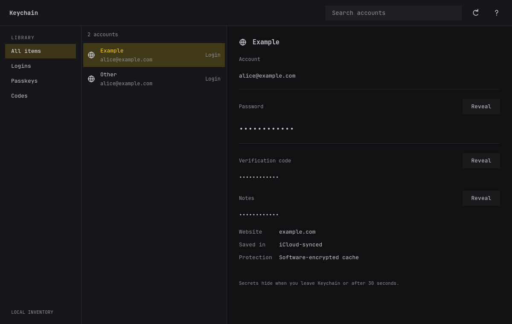

# Keychain desktop



Qt Quick frontend for the real Keychain inventory, written in Rust with CXX-Qt
0.10.0. This replaces the GPUI main application. The separate GPUI authentication
agent, root broker and SEP protocol are unchanged.

```sh
# From the repository root; Qt 6 development tools and QML/Wayland plugins required.
desktop/bin/build
./target/release/keychain gui
# Synthetic vault + real controller/Qt event loop; never uses your profile.
desktop/bin/check
```

Use `cargo build --release --locked` for the CLI and
`cargo build --release --locked --features desktop-agent --bins` for services.
Neither command compiles Qt. Build the desktop separately to place `keychain-gui`
beside the CLI in `target/release`. Qt is dynamically linked, QML is embedded.
Qt 6.12.0 and Rust 1.98.1 on Linux ARM64 are the tested development environment.
`cxx` is pinned to 1.0.205 to match bridge code generation. Keep the desktop lockfile.
Qt discovers `qmake6` automatically. If selecting a custom Qt SDK with `QMAKE`,
use the same environment for build, test and Clippy: changing it rebuilds native bindings.

The accepted [prototype](../prototypes/qt/README.md) is a historical framework
comparison. Make production UI changes here. Its fake operation controls are not
part of this executable. Styling uses Folio's audited typography, geometry, focus
and vector conventions; see [attribution](THIRD-PARTY-NOTICES.md).

The list contains metadata only, including passwords, passkeys and code-enabled
logins. Refresh reloads local inventory; cloud sync and editing stay in the CLI.
Password, current code and notes reveals are separate intentional actions. A
protected record always uses its exact broker revision/content binding; there is
no software fallback. Passkey scalars and TOTP seeds have no reveal action.
Only one reveal worker can run at a time. Late/canceled responses are discarded.
Focus loss hides displayed values; pending biometric verification may finish and
wait up to two seconds for focus to return. Displayed values expire after 30
seconds or code expiry. Qt text/GPU/accessibility copies cannot be guaranteed
zeroized; the Rust response owner wipes on drop. No automatic clipboard copies.
There is no unlocked session or reusable biometric grant.

The palette follows the full Omarchy color file live when available; otherwise
Qt's platform light/dark preference selects the fallback palette. Fonts use the
system monospace family at 13 logical pixels. No desktop configuration is changed.
Translations use `qsTr` hooks; a translated catalog and live language switching
are not yet implemented. Theme corner radius currently defaults to square.

| Shortcut | Action |
| --- | --- |
| Ctrl+F / Ctrl+K | Search |
| Tab / Shift+Tab | Move focus |
| Enter | Open focused account |
| Escape | Hide, cancel, back, clear search |
| ? | Keyboard shortcuts |
| Q | Close, outside text entry |

`bin/check` tests the production adapter/QML against an isolated encrypted
software vault in dark, light and narrow layouts. Screenshots in
`/tmp/keychain-production-{dark,light,narrow}.png` contain synthetic content only.
Controller unit tests separately cover stale results, field/identity/revision
mismatch, focus handoff, timeouts, cancellation and destruction. Biometric
hardware behavior still belongs to the existing broker/agent acceptance tests.

On Arch/Omarchy, `desktop/bin/install` builds a local `keychain-gui` package and
installs the executable, icon and desktop entry. It appears as **Keychain** in
the launcher. This GUI-only package does not install or restart broker/agent
services. The PKGBUILD stages the locally built binary; it is not a published
source package or an upstream release. Qt's system packages supply its runtime.

Validation on 2026-11-12: 261 core/agent unit tests passed (27 hardware/manual
checks skipped), three production-QML fixture runs passed, and strict Clippy
passed for both workspaces. Dark/light/narrow screenshots were inspected.
The installed executable maps on Wayland as `cameroncooper.keychain`.
Real biometric reveals were not exercised during this migration.

On this host Qt's GNOME/portal integration reports access denied when opening
`/proc/<pid>/root` and cannot register the app with the host portal. The window
still opens; process nondumpability is retained. Portal-dependent integration
remains a follow-up, and this first GUI has no portal file-picker flow.
