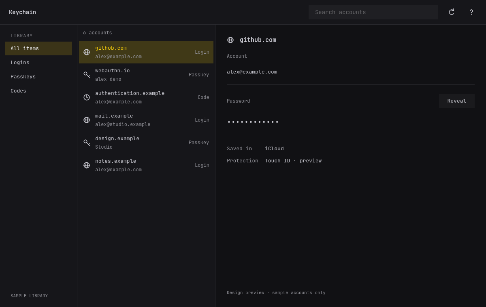

# Keychain Qt Quick prototype



A Folio-inspired interface with sample accounts, two Rust-to-Qt adapters and one
shared Rust state machine. This is an isolated design and framework experiment.
It has no dependency on the Keychain application, broker, native host or SEP driver.
It does not load real credentials or offer a real biometric authorization flow.

From the Keychain repository root:

```sh
prototypes/qt/bin/run cxxqt
prototypes/qt/bin/run qtbridge
```

Use Ctrl+F or Ctrl+K to search, Tab to move between controls, Enter to open an
account, Escape to hide/cancel/back out, and `?` for shortcut help. Reveal waits
for a synthetic worker and shows a sample value. Values hide on selection,
cancellation, window deactivation and after ten seconds. No clipboard operation
is provided. The preview banner stays visible.

The app reads the Omarchy palette from its normal colors.toml, including symlink
replacement, by polling once per second. It does not modify desktop settings.
Without that palette it uses a neutral dark theme. To inspect deterministic
light and dark variants:

```sh
KEYCHAIN_QT_THEME=light prototypes/qt/bin/run cxxqt
KEYCHAIN_QT_THEME=dark prototypes/qt/bin/run qtbridge
KEYCHAIN_QT_WIDTH=640 prototypes/qt/bin/run cxxqt
```

Compositor rounding, portal-based appearance selection and live language
switching remain follow-up work. QML labels use qsTr and the layout supports mirroring; sample metadata and
simulated status messages are currently English. Translations and assistive-technology behavior still need
separate validation.

[Light preview](docs/preview-light.png) · [Narrow preview](docs/preview-narrow.png)

[Folio spacing and typography audit](docs/FOLIO-STYLE-AUDIT.md) records the
source measurements, corrections and intentional differences.

## Shared structure

- `qml/Main.qml`: embedded in both executables; only the backend import changes.
- `model`: synthetic inventory, search/filter/selection and request generations.
- `cxxqt`: CXX-Qt 0.10.0 QObject adapter and Qt-thread dispatch.
- `qtbridge`: official Qt Bridge 0.4.1 adapter and Qt-thread dispatch.
- `Cargo.lock`: a standalone pinned graph, isolated from the real application's
  dependencies and build output.

The prototype transports a small immutable metadata snapshot into a QML list.
It exercises replacement, insertion and removal through that snapshot, not a
native incremental QAbstractListModel. Native model notifications and large-vault
scrolling performance are still framework-selection gates. Synthetic revealed
values use a separate property and are cleared before changing selected metadata.
Neither this property nor a future real QML secret display provides guaranteed
renderer/GPU memory erasure.

Workers return via each bridge's supported thread handle. Cancellation and
selection changes invalidate results by generation and identity. Synthetic work
is bounded to four pending workers. A QObject destroyed during pending work must
not receive a result. No background task owns a QML view or a real credential.

## Checks

Requires Qt 6 development/QML modules, a C++ toolchain and Rust. The official
bridge requires at least Qt 6.10. This host provides Qt 6.12. Builds use Cargo
and qmake6 for Qt discovery, with one compilation job to bound memory use.

```sh
prototypes/qt/bin/check
```

The check runs model tests and the same embedded QML smoke sequence through both
adapters in light/dark mode, using the offscreen software renderer, including a 640-pixel narrow window. It checks
search/filtering, late selection results, cancellation, synthetic failure,
worker delivery, row changes and object destruction with pending work. Logs and
screenshots are stored in the ignored `evidence/` directory. A timeout, missing
success marker or QML runtime error fails the check.

Validation passed: four model tests, six offscreen QML smoke runs (two adapters
in dark, light and narrow layouts), formatting, and workspace Clippy with warnings
denied. Each smoke also verifies the selected pane geometry. Native results on
the development Asahi machine (2026-11-12): both adapters
built for aarch64 with Qt 6.12.0 and Rust 1.98.1, and both passed the same
state/lifecycle sequence through offscreen rendering and real Wayland rendering.
Wayland launches emitted a host-portal registration warning stating that the
connection was already associated with an application ID. Its cause is not
established here; desktop identity/portal integration remains a packaging check.

CXX and its code generator must agree on their release. The lockfile pins CXX
1.0.205 and both adapters enable the same C++17/std features. An intermediate
mixed 1.0.187/1.0.205 graph produced unresolved generated symbols. The pinned
graph builds both adapters. Cold native dependencies took several minutes;
subsequent application-only builds took seconds. These are development build
observations, not controlled runtime or release-build benchmarks.

The smoke sequence is deliberately synthetic. It does not validate the root-peer
prompt protocol, fingerprint capture, trusted visibility acknowledgement or Touch
Bar integration. Real input-event, screen-reader, portal and large-inventory
checks remain separate from these state/lifecycle checks.

## References

- [Folio design assessment](../../docs/GUI-DESIGN-FOLIO.md)
- [Framework assessment](../../docs/GUI-FRAMEWORK-ASSESSMENT.md)
- [CXX-Qt](https://github.com/KDAB/cxx-qt), including its Cargo and threading examples.
- [Official Qt Bridge](https://github.com/qt/qtbridge-rust), including its QObject and thread-handle examples.

The prototype's own source follows the repository's MIT license. Adapted Folio
control patterns retain their [MIT attribution](THIRD-PARTY-NOTICES.md). Dependency
licenses include CXX-Qt's MIT/Apache options and Qt Bridge's LGPLv3/commercial
terms; this experiment does not change those dependencies' licenses.
